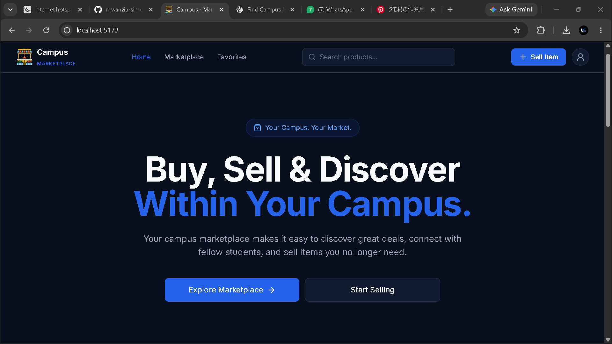

#  Campus Marketplace

A student-focused online marketplace designed to make buying and selling products within the campus community easier.



Campus Marketplace connects students who want to sell items with other students looking to buy them. Instead of relying on external marketplaces, students can discover products, connect with sellers, and trade within their campus community.

##  Project Overview

Campus Marketplace is a full-stack web application built to provide students with a simple and accessible platform for buying and selling products.

The platform aims to create a trusted campus trading environment where students can:

- Create accounts and manage their profiles.
- List products they want to sell.
- Browse products listed by other students.
- Search for products and explore categories.
- View product details and seller information.
- Save products they are interested in.
- Communicate with sellers.

##  Planned Features

### User Management
- Student registration and login.
- User authentication and authorization.
- User profile management.
- Profile picture support.

### Product Management
- Create product listings.
- Upload product images.
- Edit and delete listings.
- Set product prices and conditions.
- Manage listing status (Available, Sold, Hidden).

### Product Discovery
- Browse available products.
- Search for products.
- Filter products by category.
- View detailed product information.
- View seller information.

### Additional Features
- Save products to favorites.
- Buyer and seller messaging.
- Campus-based product discovery.
- Notifications and other marketplace improvements.

##  Tech Stack

### Frontend
- React
- TypeScript
- Vite
- Tailwind CSS

### Backend
- Node.js
- Express.js
- JavaScript

### Database
- MongoDB
- Mongoose

### Development Tools
- Git and GitHub
- Postman
- Notion

##  Database Design

The application is designed around the following main collections:

| Collection | Purpose |
|---|---|
| User | Stores student account and profile information. |
| Product | Stores product listings created by students. |
| Category | Groups similar products together. |
| Favorite | Tracks products saved by users. |
| Message | Stores communication between buyers and sellers. |

### Relationships

- A user can create multiple product listings.
- Each product belongs to one seller.
- Products belong to categories.
- Users can save multiple products as favorites.
- Users can send and receive messages related to products.

##  Project Structure

The project is organized into separate frontend and backend applications.

```text
campus-marketplace/
│
├── frontend/
│   ├── src/
│   │   ├── components/
│   │   ├── pages/
│   │   ├── hooks/
│   │   ├── services/
│   │   ├── context/
│   │   └── utils/
│   └── package.json
│
├── backend/
│   ├── config/
│   ├── controllers/
│   ├── middleware/
│   ├── models/
│   ├── routes/
│   ├── services/
│   └── package.json
│
└── README.md
```

*Note: This is a suggested high-level structure; adjust it to match the actual repository.*

##  Getting Started

### Prerequisites

Make sure you have the following installed:

- [Node.js](https://nodejs.org/)
- [MongoDB](https://www.mongodb.com/)
- npm
- Git

### 1. Clone the Repository

```bash
git clone https://github.com/mwanzia-simon/CAMPUS-MARKETPLACE
cd campus-marketplace
```

### 2. Set Up the Backend

```bash
cd backend
npm install
```

Create a `.env` file in the backend directory and configure your environment variables.

```env
PORT=5000
MONGO_URI=your_mongodb_connection_string
JWT_SECRET=your_jwt_secret
```

Start the backend development server using the script configured in your `package.json`.

### 3. Set Up the Frontend

Open another terminal:

```bash
cd frontend
npm install
npm run dev
```

Vite will provide a local development URL, usually:

```text
http://localhost:5173
```

##  Project Roadmap

- [ ] Design and implement the User schema.
- [ ] Create the User model.
- [ ] Design and implement the Product schema.
- [ ] Create the Product model.
- [ ] Design and implement the Category schema.
- [ ] Create the Category model.
- [ ] Establish database relationships.
- [ ] Test database operations.
- [ ] Implement authentication.
- [ ] Develop product listing functionality.
- [ ] Build product discovery and search.
- [ ] Implement favorites.
- [ ] Introduce buyer-seller messaging.

##  Project Goals

The long-term goal is to build a reliable and user-friendly marketplace that simplifies buying and selling within campus communities.

The project also serves as an opportunity to explore full-stack development, database design, REST API development, authentication, and scalable application architecture.

##  Contributions

Contributions, suggestions, and improvements are welcome.

If you would like to contribute:

1. Fork the repository.
2. Create a new branch.
3. Make your changes.
4. Commit your changes.
5. Open a pull request.

##  License

This project is currently under development. Licensing details will be added later.